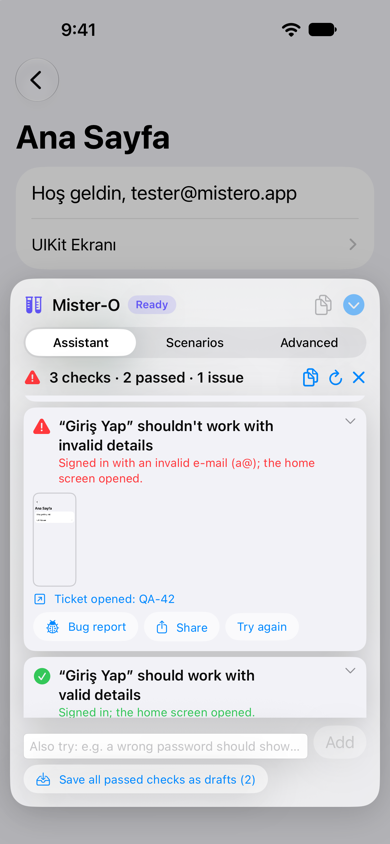
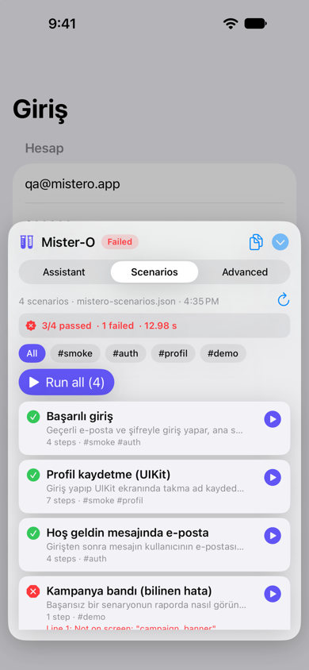
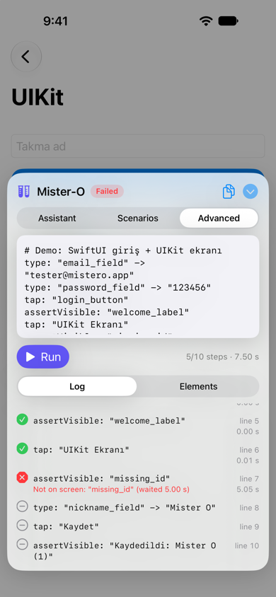
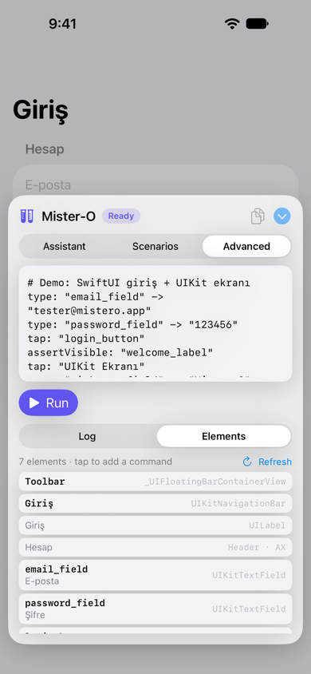

# Mister-O

[](https://swift.org)
[](docs/guide.md)
[](#installation)
[](LICENSE)

**English** · [Türkçe](README.tr.md)

UI tests that run inside your iOS app. Add Mister-O to a staging build and testers get a panel in the
app: they run ready-made scenarios, write short flows, or let an on-device AI assistant test the
screen. No Mac, no Xcode, no `XCTest`.

<p align="center">
  
  
  
  
</p>

## What it does

- **Flows in plain text:** `tap`, `type`, `assertText`, `scroll`, `back` and a few more. Steps wait for
  elements, scroll long lists to find them and tap alert buttons.
- **Scenario catalog:** one JSON file on GitHub or your server. Testers run one scenario, a tag or all
  of them with one tap.
- **AI test assistant:** tests the current screen or a check you describe, fills forms with realistic
  data, saves passing checks as scenarios and repairs broken ones.
- **Runs by itself:** scenarios run on launch or on every pull request in CI, results go to Slack and
  JUnit, and failures become tickets without duplicates.
- **Tickets in one tap:** failed checks and scenarios go to Jira, Linear or GitHub Issues with the
  steps and a screenshot.
- **SwiftUI and UIKit**, in English or Turkish.

## Installation

Add the package with Swift Package Manager:

```swift
.package(url: "https://github.com/ekucet/Mister-O.git", from: "0.5.0")
```

Link the `MisterO` library **only to a staging target**, never to the App Store build: Mister-O uses
private APIs to see SwiftUI elements and to tap alert buttons.
[Setting up a staging target](docs/guide.md#setting-up-a-staging-target) shows how, for XcodeGen and
for Xcode.

## Quick start

**SwiftUI:** attach the panel to your root view. Every parameter is optional; `.misterOTestPanel()`
alone gives you the panel.

```swift
import SwiftUI
#if STAGING
import MisterO
#endif

@main
struct MyApp: App {
    var body: some Scene {
        WindowGroup {
            ContentView()
                #if STAGING
                .misterOTestPanel(
                    scenarios: .remote(URL(string: "https://raw.githubusercontent.com/acme/qa/main/mistero.json")!),
                    resetApp: { await AppState.shared.signOut() },          // runs before each scenario
                    testData: ["Test account e-mail": "qa@acme.com",       // used as {{Test account e-mail}}
                               "Test account password": "…"],
                    issueReporter: WebhookIssueReporter(url: URL(string: "https://hooks.acme.com/mistero")!)
                )
                #endif
        }
    }
}
```

**UIKit:** call `MisterO.install(in: windowScene)` in `scene(_:willConnectTo:options:)`, with the same
parameters.

Run the staging build. A test tube bubble appears at the edge of the screen; tap it to open the panel.

## Writing a flow

```yaml
type: email_field -> {{Test account e-mail}}
type: password_field -> {{Test account password}}
tap: login_button
assertText: welcome_label -> "Welcome"
tap: Settings
tap: delete_account_button      # scrolls the list until it finds it
tap: "Delete"                   # the alert's button
back
```

| Command | Example |
|---|---|
| `tap` | `tap: login_button` |
| `type` | `type: email_field -> "qa@acme.com"` |
| `wait` | `wait: 1.5` |
| `assertVisible` · `assertNotVisible` | `assertVisible: welcome_label` |
| `assertEnabled` · `assertDisabled` | `assertDisabled: login_button` |
| `assertText` | `assertText: welcome_label -> "Welcome"` |
| `scroll` | `scroll: down` |
| `back` | `back` |

Elements are found by `accessibilityIdentifier`, accessibility label or visible text. Identifiers keep
flows working when the copy or the language changes:

```swift
Button("Sign In", action: signIn)
    .accessibilityIdentifier("login_button")
```

## Scenario catalog

Your QA team writes scenarios once; testers pick them from the **Scenarios** tab.

```json
{
  "scenarios": [
    {
      "name": "Successful login",
      "tags": ["smoke"],
      "goal": "Sign in with the test account; the home screen should open.",
      "steps": [
        "type: email_field -> {{Test account e-mail}}",
        "type: password_field -> {{Test account password}}",
        "tap: login_button",
        "assertVisible: welcome_label"
      ]
    }
  ]
}
```

Load it with `.remote(url)`, `.bundled("name")`, `.inline([...])` or your own source. Remote catalogs are
cached for offline use.

## Automatic runs

Run scenarios without anyone touching the panel:

```swift
.misterOTestPanel(
    scenarios: catalog,
    autorun: .tags("smoke"),                                        // or "autorun": "#smoke" in the catalog
    resultReporters: [SlackResultReporter(webhookURL: slackURL)]    // the summary goes to Slack
)
```

Failed scenarios become tickets through your `issueReporter`; the same failure never opens a second one.
Every run also writes `junit.xml` and `report.json`. In GitHub Actions, one step runs your staging app
on a simulator and fails the job when a scenario fails:

```yaml
- uses: ekucet/Mister-O/ci@0.5.0
  with:
    app: build/Build/Products/Debug-iphonesimulator/MyAppStaging.app
    scenarios: "#smoke"
```

See [automatic runs](docs/guide.md#automatic-runs) for launch arguments, the catalog switch and the CI
inputs.

## AI test assistant

On the **Assistant** tab, tap **Test this screen** or describe a check: *"Fill in the fields and tap
Continue; it should go to the next screen."* The assistant runs it, writes a short report, asks only
for data it can't make up, and saves passing checks as draft scenarios. **Repair with assistant** fixes a
scenario that broke because the screen changed.

It uses Apple's on-device model on iOS 26 and later with Apple Intelligence (no API key, nothing leaves
the device), or any model you plug in. The real model hasn't been run on a physical device yet; the
loop is tested with a scripted model.

## Tickets

Pass an `issueReporter` and failed checks and scenarios get an **Open ticket** button. The ticket
lists the steps, the expected and actual result, the device and a screenshot. `WebhookIssueReporter`
posts JSON to Jira Automation, Zapier or your own server, so no tracker token lives in the app.
`JiraIssueReporter` calls Jira Cloud directly if you accept that trade-off.

## Learn more

The [guide](docs/guide.md) covers everything else:
[the panel](docs/guide.md#using-the-panel) ·
[writing flows](docs/guide.md#writing-flows) ·
[scenario catalog](docs/guide.md#scenario-catalog) ·
[assistant](docs/guide.md#ai-test-assistant) ·
[tickets](docs/guide.md#opening-tickets-jira-linear-github-issues) ·
[automatic runs](docs/guide.md#automatic-runs) ·
[configuration](docs/guide.md#configuration) ·
[how it works](docs/guide.md#how-it-works) ·
[private APIs](docs/guide.md#swiftui-support-and-the-private-api) ·
[limitations](docs/guide.md#limitations) ·
[development](docs/guide.md#development)

## License

Mister-O is released under the [MIT License](LICENSE).
