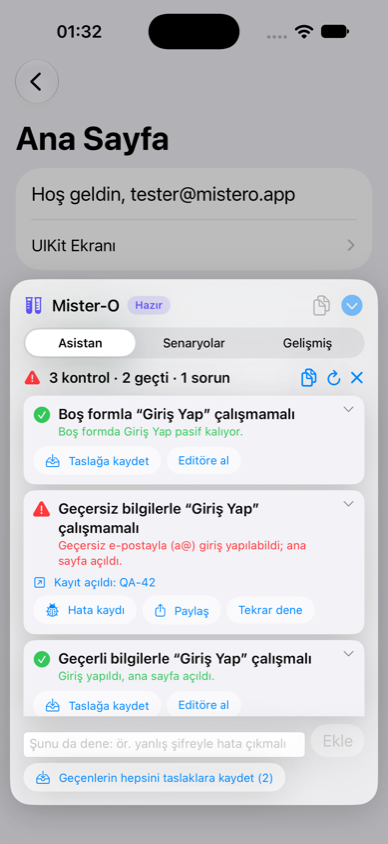

# Mister-O

[](https://swift.org)
[](#requirements)
[](#installation)
[](LICENSE)

**English** · [Türkçe](README.tr.md)

An **in-app** UI test automation SDK for iOS. Embed it in your Test/Staging builds, and testers
can write a simple flow in a panel inside the app, tap ▶︎, and watch it run step by step. No Mac,
no Xcode, no terminal, no `XCTest`.

```yaml
# login flow
type: "email_field" -> "tester@mistero.app"
type: "password_field" -> "123456"
tap: "login_button"
assertVisible: "welcome_label"
wait: 1.5
```

<p align="center">
  
  
  
  
  
</p>

## Features

- **Runs on the device.** Testers write and run flows without a computer.
- **Scenario catalog.** Define test scenarios once in a JSON file on GitHub, on your server or in
  the app. Testers pick from a list and run one scenario, a tag or all of them with one tap.
- **SwiftUI and UIKit.** Finds SwiftUI `Button`, `TextField`, `SecureField`, `NavigationLink` and
  UIKit controls by `accessibilityIdentifier`, label or visible text.
- **AI test assistant.** Tap "Test this screen", or describe a check in plain words ("fill the fields
  and tap Continue; it should move on"). An on-device model runs it, fills forms with realistic data,
  reports issues with a ready bug report, and saves passing checks as draft scenarios. It can also
  repair a failing scenario. See [AI test assistant](#ai-test-assistant).
- **Tickets in one tap.** Plug in your tracker (Jira, Linear, GitHub Issues…) and a found issue
  becomes a ticket with steps, expected and actual result, the device and a screenshot.
- **Waits for you.** `tap`, `type` and `assertVisible` wait until the element shows up or becomes
  enabled, so flows don't need sleeps after every navigation.
- **Clear results.** Each step is shown as passed, failed or skipped, with its line number,
  duration and error message. You can copy the report and paste it into a bug ticket.
- **Elements inspector.** Lists the identifiers on the current screen. Tap one to add a command
  for it to the flow.
- **Stays out of the way.** The panel lives in its own window above the app and collapses into a
  draggable bubble while a flow runs.

## Requirements

- iOS 16 or later
- Xcode 16 or later (Swift 6 toolchain)

> The panel UI and log messages are currently in Turkish.

## Installation

Add the package with Swift Package Manager and link it **only to your Test/Staging target**.
The SDK uses a private API to see SwiftUI elements (see [SwiftUI support](#swiftui-support-and-the-private-api)),
so it must never ship in an App Store build.

**Xcode:** *File → Add Package Dependencies…* → `https://github.com/ekucet/Mister-O.git` → set
*Dependency Rule* to *Up to Next Major Version* from `0.3.0` → add the `MisterO` library to your
staging target only.

**Package.swift:**

```swift
dependencies: [
    .package(url: "https://github.com/ekucet/Mister-O.git", from: "0.3.0"),
],
targets: [
    .target(name: "MyAppStaging", dependencies: [
        .product(name: "MisterO", package: "Mister-O"),
    ]),
]
```

Then add a compilation condition to the staging build, for example `STAGING` in
*Build Settings → Active Compilation Conditions*.

> Wrapping the calls in `#if STAGING` alone may not be enough. Linker flags such as `-ObjC` can
> pull unused code into the binary. Linking the package only to the staging target is the safe option.

## Quick start

**SwiftUI:** attach the panel to your root view:

```swift
import SwiftUI
#if STAGING
import MisterO
#endif

@main
struct MyApp: App {
    var body: some Scene {
        WindowGroup {
            ContentView()
                #if STAGING
                .misterOTestPanel()
                #endif
        }
    }
}
```

**UIKit:** install it once the scene connects:

```swift
func scene(_ scene: UIScene, willConnectTo session: UISceneSession, options: UIScene.ConnectionOptions) {
    guard let windowScene = scene as? UIWindowScene else { return }
    // … set up your window …
    #if STAGING
    MisterO.install(in: windowScene)
    #endif
}
```

Run the app and a test tube bubble appears at the screen edge.

## Using the panel

The panel has three tabs:

| Tab | What it's for |
|---|---|
| **Asistan** (Assistant) | Let the [AI test assistant](#ai-test-assistant) test the current screen or a check you describe |
| **Senaryolar** (Scenarios) | Run the [scenario catalog](#scenario-catalog) and the drafts the assistant saved |
| **Gelişmiş** (Advanced) | Write a flow by hand, read the run log and inspect the elements on screen |

It opens on Asistan when the assistant's model is available, otherwise on Senaryolar if you set up a
catalog, otherwise on Gelişmiş. Writing a flow by hand on the Gelişmiş tab:

1. **Open:** tap the bubble. You can drag it to either edge.
2. **Write:** type the flow into the editor. The last flow is saved and comes back on the next launch.
3. **Find identifiers:** switch from **Log** to **Öğeler** (Elements) to see what's on the current screen.
   Tap a row to add a `tap`, `assertVisible` or `type` line for it.
4. **Run:** tap **Çalıştır** (Run). The flow is checked first. If a line has a mistake, nothing
   runs and the error is shown with its line number.
5. **Watch:** the panel collapses into a progress ring so the app stays visible. Tap the ring to
   see the live log or tap **Durdur** (Stop).
6. **Read the result:** the panel opens when the run finishes and scrolls to the first failure.
   The copy button copies a plain-text report.

## Writing flows

| Command | Example | What it does |
|---|---|---|
| `tap` | `tap: "login_button"` | Taps the element |
| `type` | `type: "email_field" -> "hello"` | Clears the field, then types the text. `""` only clears it |
| `wait` | `wait: 2` | Waits for the given number of seconds (0–300, `1.5` or `1,5`) |
| `assertVisible` | `assertVisible: "welcome_label"` | Checks that the element is visible |
| `assertNotVisible` | `assertNotVisible: "error_label"` | Checks that the element is gone (waits for it to disappear) |
| `assertEnabled` | `assertEnabled: "save_button"` | Checks that the element is enabled |
| `assertDisabled` | `assertDisabled: "login_button"` | Checks that the element is disabled |

**Syntax rules**

- One step per line. Blank lines and lines starting with `#` are skipped, and a trailing ` # comment` is allowed.
- Command names are case-insensitive. YAML-style list items (`- tap: ...`) also work.
- Values can be quoted (`"..."`, `'...'`) or bare (`tap: Sign In`). Quote values that contain
  `->` or ` #`. Inside quotes, escape with `\"`, `\\` and `\n`.
- The keyboard's smart quotes (“ ” ‘ ’) and the `→` arrow are accepted.

**Element matching**

A query is compared with each visible element in this order. If several elements match, the
strongest match wins; on a tie, the frontmost element wins.

1. `accessibilityIdentifier` (exact)
2. `accessibilityLabel`
3. Visible text: button title, label text, text field content or placeholder
4. The same texts, case-insensitive

Only **visible** elements match. Hidden views, fully transparent views and views scrolled out of
a scroll view's bounds are ignored.

**Waiting and failures**

`tap`, `type` and `assertVisible` retry every 200 ms for up to 5 seconds while the element is
missing or disabled. If it still isn't there, the step fails, for example with
`Ekranda bulunamadı: "welcome_label" (5.00 sn beklendi)` ("not found on screen, waited 5 s").
By default the run stops at the first failure and marks the remaining steps as skipped.

## Scenario catalog

Instead of typing flows by hand, testers can run scenarios your QA team defines up front. Put them
in a JSON file and point the panel at it:

```swift
.misterOTestPanel(
    scenarios: .remote(URL(string: "https://raw.githubusercontent.com/acme/qa-flows/main/mistero.json")!),
    resetApp: { appModel.resetToLogin() }
)
```

What the tester does:

1. Opens the panel. The **Senaryolar** tab lists every scenario with its step count and tags.
2. Optionally picks a tag, for example `#smoke`.
3. Taps **Tümünü çalıştır** (Run all), or ▶︎ on a single row.
4. The panel collapses and the bubble shows scenario progress, for example `3/20`.
5. When the run ends, the panel shows a summary such as `17/20 başarılı · 3 başarısız · 2 dk 14 sn`
   (17/20 passed · 3 failed · 2 min 14 s). Failed rows show their first error. Tap a row to see its
   steps, or **Editöre al** to load it into the editor. The copy button copies the whole suite report.
6. If a scenario broke because the screen changed (a renamed button, a new field), **Asistanla onar**
   (Repair with assistant) on the failed row hands it to the assistant. See
   [Repairing a failing scenario](#repairing-a-failing-scenario).

A failing scenario stops at its first failed step, and the suite moves on to the next scenario.

### Catalog format

```json
{
  "scenarios": [
    {
      "id": "login-success",
      "name": "Successful login",
      "description": "Signs in with a valid account and checks the home screen.",
      "tags": ["smoke", "auth"],
      "goal": "Sign in with the test account; the home screen should open.",
      "steps": [
        "type: email_field -> tester@example.com",
        "type: password_field -> 123456",
        "tap: login_button",
        "assertVisible: welcome_label"
      ]
    },
    {
      "name": "Welcome message",
      "tags": ["auth"],
      "flow": "tap: login_button\nassertVisible: 'Welcome, tester@example.com'"
    }
  ]
}
```

| Field | Required | Meaning |
|---|---|---|
| `name` | yes | Shown in the list |
| `steps` or `flow` | yes | The flow as an array of lines, or as one multi-line string |
| `id` | no | Stable identifier. Derived from `name` if missing |
| `description` | no | Short explanation under the name |
| `tags` | no | Used to filter and to run a subset |
| `reset` | no | `false` skips `resetApp` before this scenario. Default `true` |
| `goal` | no | What the scenario should prove, in plain words. The assistant uses it to repair the scenario when its steps stop working |

Inside JSON strings, use bare values (`tap: login_button`) or single quotes (`'Welcome, …'`) so you
don't have to escape `"`. The catalog is checked when it loads. A scenario with a syntax error is
marked in red, can't be run, and is left out of **Run all**.

### Where the catalog comes from

| Feed | Use it for |
|---|---|
| `.remote(url, headers:)` | GitHub raw files, gists, S3, your own server |
| `.bundled("name")` | `name.json` shipped inside the staging app |
| `.inline([Scenario])` | Scenarios defined in code |
| `.custom(name:cacheKey:) { … }` | Anything else, such as Firebase Remote Config or your own API |

The last catalog that loaded successfully from `.remote` is cached on the device. If the source
can't be reached, testers see the cached list marked **Çevrimdışı** (Offline). The refresh button
reloads the catalog.

For a private repository, pass a token with `headers: ["Authorization": "Bearer …"]`. Anything in a
staging build can be extracted, so use a read-only token limited to that one repository.

### Starting each scenario from a known state

Scenarios in a suite run back to back. Without help, scenario 2 starts on whatever screen scenario 1
left behind. `resetApp` runs before every scenario (unless it has `"reset": false`). It should bring
the app to the state your scenarios expect, for example by popping navigation to the root and
signing out:

```swift
.misterOTestPanel(scenarios: catalog, resetApp: {
    router.path = []
    await session.signOut()
})
```

After the reset, Mister-O waits 0.6 s for the screen to settle. If you don't provide `resetApp`,
order the catalog so that each scenario continues from where the previous one ended.

## AI test assistant

> **Note:** The assistant loop, the report and the demo flow are tested. Apple's on-device model has
> not yet been run end to end on a device (see [Status](#status)).

Open the panel on any screen and switch to **Asistan**. There are two ways to start:

- **Bu ekranı test et** (Test this screen): the assistant looks at the elements on the screen and plans
  up to four checks itself, for example *"An empty form shouldn't sign in"*, *"Invalid details
  shouldn't sign in"* and *"Valid details should sign in"*. You can give it a focus first, for example
  *"only the password field"*.
- **Describe a check** in the *ya da tarif edin…* (or describe…) field, in your own words:
  *"Fill in the fields and tap Continue; it should go to the next screen, otherwise fail."*
  The part that says what should happen (*-malı/-meli* in Turkish, *should/must* in English) becomes
  the expected result. The assistant fills the fields with data that fits each one, taps, and checks
  the result. You don't need to write a flow for this.

Then:

1. The assistant runs the checks by itself while the panel shrinks to a progress bubble. Before each
   check it goes back to the starting screen by closing sheets and popping navigation, with `resetApp`
   as a last resort.
2. You get a short report, for example `3 checks · 2 passed · 1 issue`.
3. You continue from the report:
   - **Issue:** **Kayıt aç (Jira)** (Open ticket) opens a ticket in your tracker if you
     [connected one](#opening-tickets-jira-linear-github-issues). **Hata kaydı** (Bug report) copies
     the steps, expected and actual result and the device; **Paylaş** (Share) sends them anywhere.
   - **Needs info:** the assistant asks for data it can't make up, for example *"Can you give me a
     valid e-mail and password?"* Answer, and the check runs again. Your answer is remembered.
   - **Passed:** **Taslağa kaydet** (Save as draft) turns the check into a draft scenario. Drafts appear
     in the Senaryolar tab right away and can be shared with your QA lead as catalog JSON.
   - **Şunu da dene** (Try this too): describe another check and the assistant runs it.

On the demo's login screen the assistant finds a real bug in the demo app: the e-mail check only looks
for "@", so "a@" signs in. The demo passes its test account as [`testData`](#test-data-and-what-the-assistant-remembers),
so the assistant never has to ask:

```
Mister-O asistan raporu · 3 kontrol · 2 geçti · 1 sorun
✓ Boş formla “Giriş Yap” çalışmamalı
    Boş formda Giriş Yap pasif kalıyor.
✗ Geçersiz bilgilerle “Giriş Yap” çalışmamalı
    Geçersiz e-postayla (a@) giriş yapılabildi; ana sayfa açıldı.
✓ Geçerli bilgilerle “Giriş Yap” çalışmalı
    Giriş yapıldı, ana sayfa açıldı.
```

### Test data and what the assistant remembers

The assistant fills ordinary fields itself with realistic data. Mister-O tells it what kind of input
each text field expects, read from `textContentType`, `keyboardType` and `isSecureTextEntry`: `email`,
`password`, `phone`, `number`, `name`, `username`, `code`, `url`, `postal code`, `address` or `text`.
A sign-up form gets a unique address such as `qa+4821@example.com`; a negative check gets values like
`a@` on purpose.

It only asks for data that must already exist in your system: an existing account and its password, a
verification code, an order number. Give that up front with `testData`:

```swift
.misterOTestPanel(
    testData: [
        "Test account e-mail": "qa@acme.com",
        "Test account password": "…",
    ]
)
```

The keys are descriptions the model reads, the values are what it types. They're listed under
**Bildiklerim** (What I know) with a lock icon. Answers testers give in the chat are stored in the
device's Keychain and reused in later checks and after relaunches. **Unut** (Forget) removes one,
**Hepsini unut** (Forget all) removes every answer. Anything in `testData` ships inside the staging
build, so use test accounts only.

### Repairing a failing scenario

When a scenario fails, for example because a button was renamed or a field was added, its row in the
Senaryolar tab shows **Asistanla onar** (Repair with assistant). The assistant gets the scenario's
`goal` (or its name and description) with the old steps as a hint, resets the app if the scenario
uses `resetApp`, and tries to reach the goal on the current screen.

If the check passes, **Senaryoyu güncelle** (Update scenario) saves the new steps. A draft is updated
in place. A catalog scenario gets a draft copy named "… (onarıldı)" and tagged `onarıldı` (repaired),
because the catalog itself lives in your repository: share it with **Taslakları paylaş** (Share drafts)
and merge it into the catalog. If the check reports an issue instead, the scenario probably caught a real
bug, and you can open a ticket from the report.

### Opening tickets (Jira, Linear, GitHub Issues…)

Pass an `issueReporter`, and every issue in the report gets a **Kayıt aç** (Open ticket) button. The
key and link of the opened ticket appear in the report, for example *Kayıt açıldı: QA-42*. Each issue
is opened once; if it fails, the error is shown and the tester can tap again.

When a check ends with an issue, the assistant takes a screenshot of the app's key window. Mister-O's
own panel and bubble are left out. The issue card shows it as a thumbnail, and it goes to the tracker
as `screenshot.png` in `BugReport.attachments`.

The built-in `WebhookIssueReporter` posts the bug report as JSON to a URL you choose:

```swift
.misterOTestPanel(
    issueReporter: WebhookIssueReporter(
        name: "Jira",                                        // button title: "Kayıt aç (Jira)"
        url: URL(string: "https://hooks.example.com/mistero")!,
        headers: ["Authorization": "Bearer …"]               // optional
    )
)
```

```json
{
  "title": "Geçersiz bilgilerle “Giriş Yap” çalışmamalı: beklenen davranış görülmedi",
  "steps": ["type: email_field -> a@", "type: password_field -> 123456", "tap: login_button"],
  "expected": "Hata görünmeli ya da “Giriş Yap” pasif kalmalı; ekran değişmemeli.",
  "actual": "Geçersiz e-postayla (a@) giriş yapılabildi; ana sayfa açıldı.",
  "environment": "iPhone (Simülatör) · iOS 27.0 · app.mistero.demo 1.0 (1)",
  "description": "The same report as plain text, ready for the ticket body",
  "attachments": [
    { "filename": "screenshot.png", "mimeType": "image/png", "data": "iVBORw0KGgoAAAANSUhEUg…" }
  ]
}
```

`data` is the file in base64, and `attachments` is empty when there is no screenshot. The other fields
are the same as before. The screenshot makes the body much larger; if your endpoint can't take that,
pass `includesAttachments: false`.

If the response is JSON with `key` and `url` (or Jira's `self`), the report links to the ticket.
Where to point the webhook:

- **Jira:** an Automation rule with the *Incoming webhook* trigger and a *Create issue* action that
  uses `{{webhookData.title}}` and `{{webhookData.description}}`. Automation answers before the rule
  runs, so the report says *Kayıt açıldı* without a key. Automation can't turn the base64 screenshot
  into an attachment, so on this route the ticket arrives without it.
- **Zapier, Make or n8n:** a webhook trigger that creates the issue in Linear, GitHub Issues, Azure
  DevOps or anywhere else.
- **Your own backend:** creates the ticket with the tracker's API, uploads `attachments` and returns
  `{"key": …, "url": …}`. This is the way to get the screenshot into Jira without a token in the app.

A webhook keeps tracker credentials out of the app: anything in a staging build can be extracted, and
the webhook can only create tickets. That is why it is the recommended path.

#### Straight to Jira Cloud

`JiraIssueReporter` is opt-in. It calls the Jira Cloud REST API v3 from the app:

```swift
#if STAGING
.misterOTestPanel(
    issueReporter: JiraIssueReporter(
        baseURL: URL(string: "https://yourcompany.atlassian.net")!,
        projectKey: "QA",
        issueType: "Bug",                                    // the issue type's name in the project
        authorization: JiraIssueReporter.basicAuthorization(email: "mistero-bot@yourcompany.com",
                                                            apiToken: "…")
    )
)
#endif
```

1. `POST /rest/api/3/issue` creates the issue. The summary is the report title, and the description
   (in Atlassian Document Format) lists the steps, expected and actual result and the device.
2. `POST /rest/api/3/issue/{key}/attachments` (with `X-Atlassian-Token: no-check`) uploads the
   screenshot.

The report links to `…/browse/QA-42`. If Jira rejects the issue (a wrong project key or issue type,
for example), the error is shown as Jira words it. If only the upload fails, the ticket still counts as
opened, so a second tap doesn't create a duplicate, and the report says why under the key.
`authorization` is the whole `Authorization` header value, so `Bearer …` works too. Jira Data Center
has no REST v3; use a webhook there.

> [!WARNING]
> The token ships inside the app. Anything in a staging build can be extracted: the binary, its
> strings, environment values, the Keychain. Whoever has the token can do everything its account can
> do in Jira, not just open tickets. Prefer the webhook. If you use `JiraIssueReporter`, give it the
> token of a separate account that can only create issues in that one project, keep it out of release
> builds, and revoke the token if a build leaks.

For other trackers, conform to `IssueReporter`. `report.attachments` holds the screenshot:

```swift
struct LinearReporter: IssueReporter {
    let name = "Linear"

    func open(_ report: BugReport) async throws -> IssueReceipt {
        // Create the issue from report.title and report.text, upload report.attachments,
        // then return its key and link.
    }
}
```

Without an `issueReporter`, testers still have **Hata kaydı** and **Paylaş**.

### How it stays reliable with a small model

- **Choices only from the screen:** guided generation limits the action to `tap`, `type`, the four
  `assert…` commands, `ask`, `pass`, `issue` and `blocked`, and the target to elements that are on
  screen right now. The model can't invent identifiers or write invalid lines.
- **It sees state:** each element comes with its kind, whether it is disabled and, for text fields,
  its current value.
- **One step at a time:** every turn starts a fresh session with a short summary, so the small context
  window (4,096 tokens on iOS 26) never fills up.
- **Everything is executed:** each step really runs. Failures are fed back to the model, a check stops
  after three failed steps in a row or eight steps in total, and the screen gets 0.7 s to settle after
  every step.
- **A fallback plan:** if the model returns no plan, or a custom model doesn't plan, a rule-based
  planner proposes the usual form checks.

### Drafts and resets

A saved check becomes a draft scenario tagged `taslak` and `asistan`. If the test started on the app's
root screen and you provided `resetApp`, the draft resets the app before it runs. Otherwise it is marked
"reset yok" (no reset) and should be run from the screen it was recorded on. The check's description is
kept as the draft's `goal`, so the draft can be [repaired](#repairing-a-failing-scenario) later.

### Requirements

The default model is Apple's on-device model (Foundation Models). It needs iOS 26 or later, a device
that supports Apple Intelligence, and Apple Intelligence turned on. When the model isn't available,
the tab explains why. Turkish is among the supported languages. Everything runs on the device: no API
key, no network, no cost.

### Using a different model

Pass any type that conforms to `FlowAssistantModel`, for example a company proxy to a larger model.
`plan(for:)` and `check(for:context:)` are optional; without them the rule-based planner plans the
screen and turns a described check into a title and an expected result.

```swift
struct ProxyModel: FlowAssistantModel {
    var availability: AssistantAvailability { .available }

    func plan(for context: PlanContext) async throws -> [PlannedCheck] {
        // Send context.prompt to your service and map the reply.
    }

    func check(for request: String, context: PlanContext) async throws -> PlannedCheck {
        // Turn the tester's sentence into a title and an expected result.
    }

    func nextDecision(for context: AssistantContext) async throws -> AssistantDecision {
        // Send context.prompt and context.targets to your service and map the reply.
    }
}

.misterOTestPanel(assistantModel: ProxyModel())
```

With a remote model, the screen's element names and the tester's answers leave the device.

### Status

- The assistant (planning order, issues, questions and re-runs, returning to the start screen, stopping,
  bug reports, drafts, described checks, remembered facts, repairs, opening tickets, screenshots) is
  covered by unit tests with a scripted model. The requests `WebhookIssueReporter` and
  `JiraIssueReporter` send are unit-tested; `JiraIssueReporter` hasn't been run against a live Jira
  site yet.
- On the iOS 27 simulator, the demo's rule-based model (`MISTERO_ASSISTANT=demo`) ran the whole loop:
  three checks with no questions thanks to `testData`, the "a@" bug found and turned into a ticket
  through a local webhook, a described "fill the fields and continue" check, drafts saved and run, and a
  failing catalog scenario repaired into an "(onarıldı)" draft.
- Parsing Apple's answers and building its schemas is unit-tested without the model. Two integration
  tests call the real model and are skipped when it isn't available.
- The iOS Simulator reports the model as available, but generation fails with "Simulator is not
  supported" from Apple's safety filter, so the real model has to be tried on a device.

## Making your app testable

Identifiers make flows stable across copy changes and localizations:

```swift
// SwiftUI
TextField("Email", text: $email)
    .accessibilityIdentifier("email_field")
Button("Sign In", action: signIn)
    .accessibilityIdentifier("login_button")
```

```swift
// UIKit
emailField.accessibilityIdentifier = "email_field"
```

Matching on visible text (`tap: "Sign In"`) works too, but it breaks when the copy or the device
language changes.

## Configuration

```swift
.misterOTestPanel(
    initialScript: "tap: \"login_button\"",          // shown the first time the panel opens
    scenarios: .bundled("mistero-scenarios"),        // scenario catalog (see above)
    resetApp: { router.path = [] },                  // runs before each scenario
    assistantModel: nil,                             // nil = Apple on-device model on iOS 26+
    testData: ["Test e-mail": "qa@acme.com"],        // data the assistant can't make up
    issueReporter: WebhookIssueReporter(url: hook),  // "Kayıt aç" (Open ticket) on issues
    configuration: .init(
        elementTimeout: .seconds(8),                 // wait per element (default 5 s)
        pollInterval: .milliseconds(200),            // how often to look again
        delayBetweenSteps: .milliseconds(400),       // pause between steps
        stopOnFailure: true                          // keep going after a failure if false
    ),
    enablesSwiftUIAccessibility: true                // set to false for UIKit-only apps
)
```

`MisterO.install(in:initialScript:scenarios:resetApp:assistantModel:testData:issueReporter:configuration:enablesSwiftUIAccessibility:)`
takes the same parameters. `MisterO.uninstall()` removes the panel and restores the accessibility setting.

## Running flows from code

The installed runner is available as `MisterO.runner`. It runs on the main actor:

```swift
if let runner = MisterO.runner {
    let state = await runner.run("""
    tap: "login_button"
    assertVisible: "welcome_label"
    """)
    print(state, runner.reportText)
}
```

The catalog is available as `MisterO.scenarios`:

```swift
if let catalog = MisterO.scenarios {
    await catalog.runSuite(catalog.scenarios.filter { $0.tags.contains("smoke") })
    print(catalog.suiteReportText)
}
```

The runner talks to the screen through the `UIDriver` protocol, so you can create
`InAppTestRunner(driver:configuration:)` with your own driver, for example a fake one in unit tests.

## How it works

```
MisterOCore  (Foundation only, unit-tested on macOS)
├── FlowParser          text → [TestStep]; collects all errors with line numbers
├── InAppTestRunner     @MainActor async/await engine: order, waiting, timeouts, cancel, report
├── UIDriver            protocol the runner uses to talk to the screen
├── ScenarioFeed        where the scenario catalog comes from (remote, bundled, inline, custom)
├── ScenarioStore       loads, caches and checks the catalog; runs one scenario or a suite
├── FlowAssistant       plans checks for the screen, runs them, reports, continues with the tester
├── FlowAssistantModel  protocol for the language model behind the assistant
├── AppleFlowAssistantModel  Apple on-device model with guided generation (iOS 26+)
└── IssueReporter       turns a found issue into a ticket (WebhookIssueReporter, JiraIssueReporter)

MisterO  (UIKit + SwiftUI)
├── UIKitDriver         UIDriver = ViewResolver + ActionExecutor
├── ViewResolver        walks the UIWindow hierarchy recursively, matches and ranks elements
├── ActionExecutor      performs tap / type through public UIKit APIs
├── AccessibilityBootstrap  makes SwiftUI elements visible to the resolver
├── ScreenAnchor        brings the assistant back to its start screen; Keychain memory for answers
├── ScreenCapture       screenshot of the app's key window for tickets (the overlay is left out)
└── Panel               SwiftUI panel in a separate overlay window
```

Mister-O doesn't create synthetic touches. It uses public UIKit APIs:

| Element | How it's driven |
|---|---|
| `UIButton` and other `UIControl`s | `sendActions(for: .touchUpInside)`. `UIButton` fires its `primaryAction` itself; other controls also get `.primaryActionTriggered` |
| `UISwitch` | flips the value and sends `.valueChanged` |
| `UITableViewCell` / `UICollectionViewCell` | selects the row and calls the delegate's `didSelect…` |
| SwiftUI `Button`, `NavigationLink`, … | `accessibilityActivate()` on the accessibility element |
| Text input (UIKit, SwiftUI `TextField` / `SecureField` / `TextEditor`) | `becomeFirstResponder()` + `UIKeyInput.insertText(_:)` |

`insertText` behaves like real keyboard input: delegates, `.editingChanged` and SwiftUI `@State`
bindings all update. A disabled control (UIKit `isEnabled == false` or SwiftUI `.disabled`) counts
as "not yet" and is retried until the timeout.

The resolver skips the panel's own window. That's why the panel's buttons never collide with
queries in your flow.

## SwiftUI support and the private API

SwiftUI doesn't expose `Button`, `Text` and similar views as `UIView`s. It exposes them as
accessibility elements, and it only builds those elements while app accessibility is on
(VoiceOver, XCUITest and so on). When it's off, the resolver can't see SwiftUI elements or
their `.accessibilityIdentifier`.

`AccessibilityBootstrap` turns the setting on with the **private** function
`_AXSApplicationAccessibilitySetEnabled` from `libAccessibility`. KIF and AccessibilitySnapshot
use the same approach.

- The setting is **system-wide and persistent**. Mister-O turns it on only while your app is in
  the foreground. When the app moves to the background, or when you call `MisterO.uninstall()`,
  it restores the original value. The original value is saved to disk, so it's restored correctly
  even after a crash.
- Because this is a private API, **don't ship the SDK in App Store builds**. External TestFlight
  review may also flag it.
- For UIKit-only apps you can turn it off: `.misterOTestPanel(enablesSwiftUIAccessibility: false)`.

## Limitations

- **Gesture recognizers:** UIKit views that respond to taps only through a `UITapGestureRecognizer`
  can't be triggered with public APIs. The step fails as "not tappable".
- **No real touches:** an action still runs if another view covers the element. On ties the
  frontmost element is chosen, but no hit-test check is done.
- **Out-of-process UI:** system permission alerts, the "Save Password?" prompt after a login, the
  keyboard itself, share sheet contents and web content inside `WKWebView` can't be reached. Such
  prompts don't block programmatic steps, but testers may need to dismiss them by hand.
- **Tested so far:** on the iOS 27 simulator, the demo flow passes end to end with SwiftUI
  `TextField` / `SecureField` / `Button` / `NavigationLink` and UIKit `UITextField` /
  `UIButton(primaryAction:)`. A four-scenario suite with `resetApp`, a remote catalog and the
  offline cache were also checked there. Physical devices, `UIAlertController` buttons and
  iOS 16–26 are not tested yet.

## Development

Run the parser and runner tests on your Mac:

```bash
swift test
```

Run everything, including the UIKit tests, on a simulator:

```bash
xcodebuild test -scheme MisterO -destination 'platform=iOS Simulator,name=iPhone 17'
```

A demo app with a SwiftUI login screen and a UIKit screen lives in `Examples/MisterODemo`. It ships
a four-scenario catalog (`Sources/mistero-scenarios.json`, one of which fails on purpose) and a
`resetApp` handler. Set the `MISTERO_SCENARIOS_URL` environment variable to load the catalog from a URL
instead. Set `MISTERO_ASSISTANT=demo` to try the Asistan tab with a rule-based stand-in model where
the Apple model isn't available, and `MISTERO_ISSUE_WEBHOOK` to a URL to try **Kayıt aç** against your
own webhook:

```bash
open Examples/MisterODemo/MisterODemo.xcodeproj
```

The demo project is generated from `project.yml` with [XcodeGen](https://github.com/yonaskolb/XcodeGen).
After editing that file, run `xcodegen generate` again.

## License

Mister-O is released under the [MIT License](LICENSE).
