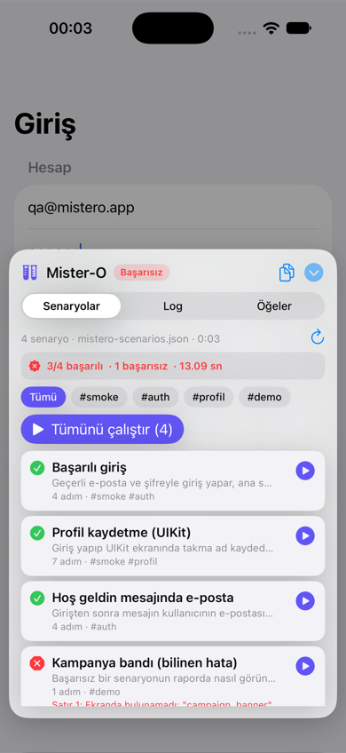
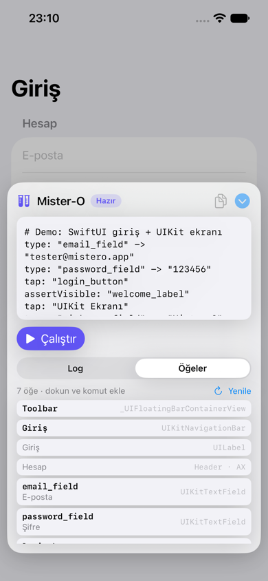
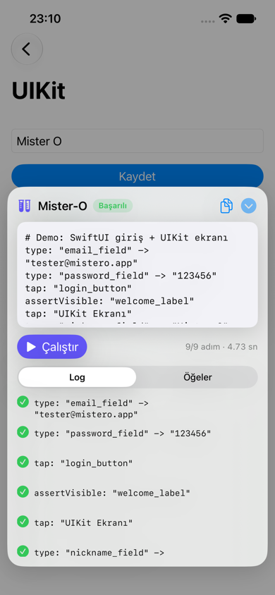
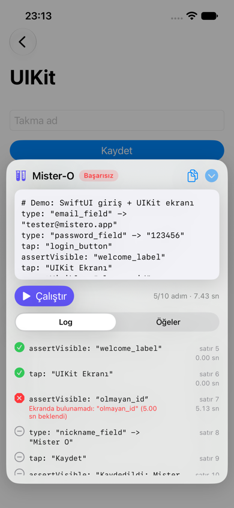

# Mister-O

[](https://swift.org)
[](#requirements)
[](#installation)
[](LICENSE)

**English** · [Türkçe](README.tr.md)

An **in-app** UI test automation SDK for iOS. Embed it in your Test/Staging builds, and testers
can write a simple flow in a panel inside the app, tap ▶︎, and watch it run step by step. No Mac,
no Xcode, no terminal, no `XCTest`.

```yaml
# login flow
type: "email_field" -> "tester@mistero.app"
type: "password_field" -> "123456"
tap: "login_button"
assertVisible: "welcome_label"
wait: 1.5
```

<p align="center">
  
  
  
  
</p>

## Features

- **Runs on the device.** Testers write and run flows without a computer.
- **Scenario catalog.** Define test scenarios once in a JSON file on GitHub, on your server or in
  the app. Testers pick from a list and run one scenario, a tag or all of them with one tap.
- **SwiftUI and UIKit.** Finds SwiftUI `Button`, `TextField`, `SecureField`, `NavigationLink` and
  UIKit controls by `accessibilityIdentifier`, label or visible text.
- **Waits for you.** `tap`, `type` and `assertVisible` wait until the element shows up or becomes
  enabled, so flows don't need sleeps after every navigation.
- **Clear results.** Each step is shown as passed, failed or skipped, with its line number,
  duration and error message. You can copy the report and paste it into a bug ticket.
- **Elements inspector.** Lists the identifiers on the current screen. Tap one to add a command
  for it to the flow.
- **Stays out of the way.** The panel lives in its own window above the app and collapses into a
  draggable bubble while a flow runs.

## Requirements

- iOS 16 or later
- Xcode 16 or later (Swift 6 toolchain)

> The panel UI and log messages are currently in Turkish.

## Installation

Add the package with Swift Package Manager and link it **only to your Test/Staging target**.
The SDK uses a private API to see SwiftUI elements (see [SwiftUI support](#swiftui-support-and-the-private-api)),
so it must never ship in an App Store build.

**Xcode:** *File → Add Package Dependencies…* → `https://github.com/ekucet/Mister-O.git` → set
*Dependency Rule* to *Up to Next Major Version* from `0.2.0` → add the `MisterO` library to your
staging target only.

**Package.swift:**

```swift
dependencies: [
    .package(url: "https://github.com/ekucet/Mister-O.git", from: "0.2.0"),
],
targets: [
    .target(name: "MyAppStaging", dependencies: [
        .product(name: "MisterO", package: "Mister-O"),
    ]),
]
```

Then add a compilation condition to the staging build, for example `STAGING` in
*Build Settings → Active Compilation Conditions*.

> Wrapping the calls in `#if STAGING` alone may not be enough. Linker flags such as `-ObjC` can
> pull unused code into the binary. Linking the package only to the staging target is the safe option.

## Quick start

**SwiftUI:** attach the panel to your root view:

```swift
import SwiftUI
#if STAGING
import MisterO
#endif

@main
struct MyApp: App {
    var body: some Scene {
        WindowGroup {
            ContentView()
                #if STAGING
                .misterOTestPanel()
                #endif
        }
    }
}
```

**UIKit:** install it once the scene connects:

```swift
func scene(_ scene: UIScene, willConnectTo session: UISceneSession, options: UIScene.ConnectionOptions) {
    guard let windowScene = scene as? UIWindowScene else { return }
    // … set up your window …
    #if STAGING
    MisterO.install(in: windowScene)
    #endif
}
```

Run the app and a test tube bubble appears at the screen edge.

## Using the panel

If you set up a [scenario catalog](#scenario-catalog), the panel opens on **Senaryolar**
(Scenarios). The editor below is for quick, one-off flows.

1. **Open:** tap the bubble. You can drag it to either edge.
2. **Write:** type the flow into the editor. The last flow is saved and comes back on the next launch.
3. **Find identifiers:** switch to **Öğeler** (Elements) to see what's on the current screen.
   Tap a row to add a `tap`, `assertVisible` or `type` line for it.
4. **Run:** tap **Çalıştır** (Run). The flow is checked first. If a line has a mistake, nothing
   runs and the error is shown with its line number.
5. **Watch:** the panel collapses into a progress ring so the app stays visible. Tap the ring to
   see the live log or tap **Durdur** (Stop).
6. **Read the result:** the panel opens when the run finishes and scrolls to the first failure.
   The copy button copies a plain-text report.

## Writing flows

| Command | Example | What it does |
|---|---|---|
| `tap` | `tap: "login_button"` | Taps the element |
| `type` | `type: "email_field" -> "hello"` | Clears the field, then types the text. `""` only clears it |
| `wait` | `wait: 2` | Waits for the given number of seconds (0–300, `1.5` or `1,5`) |
| `assertVisible` | `assertVisible: "welcome_label"` | Checks that the element is visible |

**Syntax rules**

- One step per line. Blank lines and lines starting with `#` are skipped, and a trailing ` # comment` is allowed.
- Command names are case-insensitive. YAML-style list items (`- tap: ...`) also work.
- Values can be quoted (`"..."`, `'...'`) or bare (`tap: Sign In`). Quote values that contain
  `->` or ` #`. Inside quotes, escape with `\"`, `\\` and `\n`.
- The keyboard's smart quotes (“ ” ‘ ’) and the `→` arrow are accepted.

**Element matching**

A query is compared with each visible element in this order. If several elements match, the
strongest match wins; on a tie, the frontmost element wins.

1. `accessibilityIdentifier` (exact)
2. `accessibilityLabel`
3. Visible text: button title, label text, text field content or placeholder
4. The same texts, case-insensitive

Only **visible** elements match. Hidden views, fully transparent views and views scrolled out of
a scroll view's bounds are ignored.

**Waiting and failures**

`tap`, `type` and `assertVisible` retry every 200 ms for up to 5 seconds while the element is
missing or disabled. If it still isn't there, the step fails, for example with
`Ekranda bulunamadı: "welcome_label" (5.00 sn beklendi)` ("not found on screen, waited 5 s").
By default the run stops at the first failure and marks the remaining steps as skipped.

## Scenario catalog

Instead of typing flows by hand, testers can run scenarios your QA team defines up front. Put them
in a JSON file and point the panel at it:

```swift
.misterOTestPanel(
    scenarios: .remote(URL(string: "https://raw.githubusercontent.com/acme/qa-flows/main/mistero.json")!),
    resetApp: { appModel.resetToLogin() }
)
```

What the tester does:

1. Opens the panel. The **Senaryolar** tab lists every scenario with its step count and tags.
2. Optionally picks a tag, for example `#smoke`.
3. Taps **Tümünü çalıştır** (Run all), or ▶︎ on a single row.
4. The panel collapses and the bubble shows scenario progress, for example `3/20`.
5. When the run ends, the panel shows a summary such as `17/20 başarılı · 3 başarısız · 2 dk 14 sn`
   (17/20 passed · 3 failed · 2 min 14 s). Failed rows show their first error. Tap a row to see its
   steps, or **Editöre al** to load it into the editor. The copy button copies the whole suite report.

A failing scenario stops at its first failed step, and the suite moves on to the next scenario.

### Catalog format

```json
{
  "scenarios": [
    {
      "id": "login-success",
      "name": "Successful login",
      "description": "Signs in with a valid account and checks the home screen.",
      "tags": ["smoke", "auth"],
      "steps": [
        "type: email_field -> tester@example.com",
        "type: password_field -> 123456",
        "tap: login_button",
        "assertVisible: welcome_label"
      ]
    },
    {
      "name": "Welcome message",
      "tags": ["auth"],
      "flow": "tap: login_button\nassertVisible: 'Welcome, tester@example.com'"
    }
  ]
}
```

| Field | Required | Meaning |
|---|---|---|
| `name` | yes | Shown in the list |
| `steps` or `flow` | yes | The flow as an array of lines, or as one multi-line string |
| `id` | no | Stable identifier. Derived from `name` if missing |
| `description` | no | Short explanation under the name |
| `tags` | no | Used to filter and to run a subset |
| `reset` | no | `false` skips `resetApp` before this scenario. Default `true` |

Inside JSON strings, use bare values (`tap: login_button`) or single quotes (`'Welcome, …'`) so you
don't have to escape `"`. The catalog is checked when it loads. A scenario with a syntax error is
marked in red, can't be run, and is left out of **Run all**.

### Where the catalog comes from

| Feed | Use it for |
|---|---|
| `.remote(url, headers:)` | GitHub raw files, gists, S3, your own server |
| `.bundled("name")` | `name.json` shipped inside the staging app |
| `.inline([Scenario])` | Scenarios defined in code |
| `.custom(name:cacheKey:) { … }` | Anything else, such as Firebase Remote Config or your own API |

The last catalog that loaded successfully from `.remote` is cached on the device. If the source
can't be reached, testers see the cached list marked **Çevrimdışı** (Offline). The refresh button
reloads the catalog.

For a private repository, pass a token with `headers: ["Authorization": "Bearer …"]`. Anything in a
staging build can be extracted, so use a read-only token limited to that one repository.

### Starting each scenario from a known state

Scenarios in a suite run back to back. Without help, scenario 2 starts on whatever screen scenario 1
left behind. `resetApp` runs before every scenario (unless it has `"reset": false`). It should bring
the app to the state your scenarios expect, for example by popping navigation to the root and
signing out:

```swift
.misterOTestPanel(scenarios: catalog, resetApp: {
    router.path = []
    await session.signOut()
})
```

After the reset, Mister-O waits 0.6 s for the screen to settle. If you don't provide `resetApp`,
order the catalog so that each scenario continues from where the previous one ended.

## Making your app testable

Identifiers make flows stable across copy changes and localizations:

```swift
// SwiftUI
TextField("Email", text: $email)
    .accessibilityIdentifier("email_field")
Button("Sign In", action: signIn)
    .accessibilityIdentifier("login_button")
```

```swift
// UIKit
emailField.accessibilityIdentifier = "email_field"
```

Matching on visible text (`tap: "Sign In"`) works too, but it breaks when the copy or the device
language changes.

## Configuration

```swift
.misterOTestPanel(
    initialScript: "tap: \"login_button\"",          // shown the first time the panel opens
    scenarios: .bundled("mistero-scenarios"),        // scenario catalog (see above)
    resetApp: { router.path = [] },                  // runs before each scenario
    configuration: .init(
        elementTimeout: .seconds(8),                 // wait per element (default 5 s)
        pollInterval: .milliseconds(200),            // how often to look again
        delayBetweenSteps: .milliseconds(400),       // pause between steps
        stopOnFailure: true                          // keep going after a failure if false
    ),
    enablesSwiftUIAccessibility: true                // set to false for UIKit-only apps
)
```

`MisterO.install(in:initialScript:scenarios:resetApp:configuration:enablesSwiftUIAccessibility:)`
takes the same parameters. `MisterO.uninstall()` removes the panel and restores the accessibility setting.

## Running flows from code

The installed runner is available as `MisterO.runner`. It runs on the main actor:

```swift
if let runner = MisterO.runner {
    let state = await runner.run("""
    tap: "login_button"
    assertVisible: "welcome_label"
    """)
    print(state, runner.reportText)
}
```

The catalog is available as `MisterO.scenarios`:

```swift
if let catalog = MisterO.scenarios {
    await catalog.runSuite(catalog.scenarios.filter { $0.tags.contains("smoke") })
    print(catalog.suiteReportText)
}
```

The runner talks to the screen through the `UIDriver` protocol, so you can create
`InAppTestRunner(driver:configuration:)` with your own driver, for example a fake one in unit tests.

## How it works

```
MisterOCore  (Foundation only, unit-tested on macOS)
├── FlowParser          text → [TestStep]; collects all errors with line numbers
├── InAppTestRunner     @MainActor async/await engine: order, waiting, timeouts, cancel, report
├── UIDriver            protocol the runner uses to talk to the screen
├── ScenarioFeed        where the scenario catalog comes from (remote, bundled, inline, custom)
└── ScenarioStore       loads, caches and checks the catalog; runs one scenario or a suite

MisterO  (UIKit + SwiftUI)
├── UIKitDriver         UIDriver = ViewResolver + ActionExecutor
├── ViewResolver        walks the UIWindow hierarchy recursively, matches and ranks elements
├── ActionExecutor      performs tap / type through public UIKit APIs
├── AccessibilityBootstrap  makes SwiftUI elements visible to the resolver
└── Panel               SwiftUI panel in a separate overlay window
```

Mister-O doesn't create synthetic touches. It uses public UIKit APIs:

| Element | How it's driven |
|---|---|
| `UIButton` and other `UIControl`s | `sendActions(for: .touchUpInside)`. `UIButton` fires its `primaryAction` itself; other controls also get `.primaryActionTriggered` |
| `UISwitch` | flips the value and sends `.valueChanged` |
| `UITableViewCell` / `UICollectionViewCell` | selects the row and calls the delegate's `didSelect…` |
| SwiftUI `Button`, `NavigationLink`, … | `accessibilityActivate()` on the accessibility element |
| Text input (UIKit, SwiftUI `TextField` / `SecureField` / `TextEditor`) | `becomeFirstResponder()` + `UIKeyInput.insertText(_:)` |

`insertText` behaves like real keyboard input: delegates, `.editingChanged` and SwiftUI `@State`
bindings all update. A disabled control (UIKit `isEnabled == false` or SwiftUI `.disabled`) counts
as "not yet" and is retried until the timeout.

The resolver skips the panel's own window. That's why the panel's buttons never collide with
queries in your flow.

## SwiftUI support and the private API

SwiftUI doesn't expose `Button`, `Text` and similar views as `UIView`s. It exposes them as
accessibility elements, and it only builds those elements while app accessibility is on
(VoiceOver, XCUITest and so on). When it's off, the resolver can't see SwiftUI elements or
their `.accessibilityIdentifier`.

`AccessibilityBootstrap` turns the setting on with the **private** function
`_AXSApplicationAccessibilitySetEnabled` from `libAccessibility`. KIF and AccessibilitySnapshot
use the same approach.

- The setting is **system-wide and persistent**. Mister-O turns it on only while your app is in
  the foreground. When the app moves to the background, or when you call `MisterO.uninstall()`,
  it restores the original value. The original value is saved to disk, so it's restored correctly
  even after a crash.
- Because this is a private API, **don't ship the SDK in App Store builds**. External TestFlight
  review may also flag it.
- For UIKit-only apps you can turn it off: `.misterOTestPanel(enablesSwiftUIAccessibility: false)`.

## Limitations

- **Gesture recognizers:** UIKit views that respond to taps only through a `UITapGestureRecognizer`
  can't be triggered with public APIs. The step fails as "not tappable".
- **No real touches:** an action still runs if another view covers the element. On ties the
  frontmost element is chosen, but no hit-test check is done.
- **Out-of-process UI:** system permission alerts, the keyboard itself, share sheet contents and
  web content inside `WKWebView` can't be reached.
- **Tested so far:** on the iOS 27 simulator, the demo flow passes end to end with SwiftUI
  `TextField` / `SecureField` / `Button` / `NavigationLink` and UIKit `UITextField` /
  `UIButton(primaryAction:)`. A four-scenario suite with `resetApp`, a remote catalog and the
  offline cache were also checked there. Physical devices, `UIAlertController` buttons and
  iOS 16–26 are not tested yet.

## Development

Run the parser and runner tests on your Mac:

```bash
swift test
```

Run everything, including the UIKit tests, on a simulator:

```bash
xcodebuild test -scheme MisterO -destination 'platform=iOS Simulator,name=iPhone 17'
```

A demo app with a SwiftUI login screen and a UIKit screen lives in `Examples/MisterODemo`. It ships
a four-scenario catalog (`Sources/mistero-scenarios.json`, one of which fails on purpose) and a
`resetApp` handler. Set the `MISTERO_SCENARIOS_URL` environment variable to load the catalog from a URL
instead:

```bash
open Examples/MisterODemo/MisterODemo.xcodeproj
```

The demo project is generated from `project.yml` with [XcodeGen](https://github.com/yonaskolb/XcodeGen).
After editing that file, run `xcodegen generate` again.

## License

Mister-O is released under the [MIT License](LICENSE).
